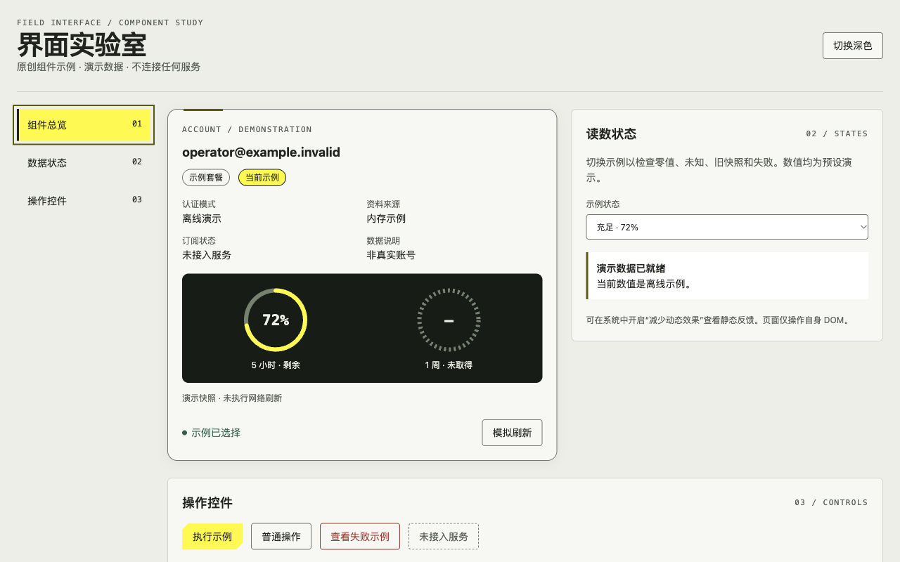
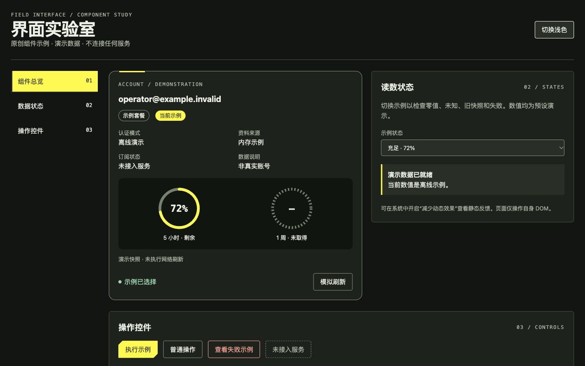

# Atelier Skills

面向 Codex 的可复用 Skills 专栏。每项技能按需组织 `SKILL.md`、专题参考、示例资源与工具，让指令可以执行、依据可以追溯、结果可以检查。

## 技能目录

| Skill | 用途 | 内容 | 分发包 |
| --- | --- | --- | --- |
| [终末地 UI 设计](skills/endfield-ui-design/SKILL.md) | 设计、实现和审查终末地风格界面、组件与动效 | 21 篇参考、8 张研究截图、官网实测、21 个仓库索引、原创 CSS 预览及 3 个工具脚本 | [下载 v1.0.0](https://github.com/zixin947/atelier-skills/raw/refs/heads/main/packages/endfield-ui-design.skill) |

后续技能继续按独立目录加入，不需要一并加载整个资料库。

## 终末地 UI 设计

从版面层级、纸墨表面、信号色、形状分工与短动效出发，区分官网、游戏操作界面、桌面工具和版本物料。保留目标项目技术栈与业务范围，避免把终末地简化成黑黄配色或满屏切角。

- [入口与任务路由](skills/endfield-ui-design/SKILL.md)
- [完整参考目录](skills/endfield-ui-design/references/index.md)
- [来源索引](skills/endfield-ui-design/references/source-registry.md)与[画面证据](skills/endfield-ui-design/references/visual-evidence.md)
- [原创控件预览源码](skills/endfield-ui-design/assets/preview.html)
- [验证记录](docs/endfield-validation.json)

### 浅色与深色示例

以下是 Skill 自带的原创离线示例，使用演示数据，不是游戏官方界面或 Codex Atelier 原生截图。





## 安装到本地技能目录

先克隆仓库：

```bash
git clone https://github.com/zixin947/atelier-skills.git
cd atelier-skills
```

运行下面的 Python 命令，将技能放入 `CODEX_HOME/skills`，未设置时使用 `~/.codex/skills`。目标目录已存在时命令会停止，不覆盖已有版本。

```python
from pathlib import Path
import os
import shutil

source = Path("skills/endfield-ui-design")
destination = Path(os.environ.get("CODEX_HOME", str(Path.home() / ".codex"))) / "skills" / source.name
destination.parent.mkdir(parents=True, exist_ok=True)
shutil.copytree(source, destination)
print(destination)
```

也可下载 `.skill` 分发包；它是 ZIP 格式，解压后将完整的 `endfield-ui-design` 目录放入相同位置。不要只复制入口文件，参考与资源需要一起保留。

在能发现该技能的 Codex 对话中调用：

```text
$endfield-ui-design 为当前项目设计终末地风格界面，保持现有技术栈与功能范围。
```

新对话的自动选择仍取决于客户端的技能发现状态；本仓库的本地安装副本已检查，未执行新对话自动选用验收。

## 本地查看原创预览

在仓库根目录运行：

```bash
python3 -m http.server 8765 --bind 127.0.0.1 --directory skills/endfield-ui-design/assets
```

打开 `http://127.0.0.1:8765/preview.html`，可以切换主题、读数状态与模拟加载。预览只操作自身页面，不连接账号或真实系统。

## 检查与打包

工具需要 Python 3.9 或更高版本，无额外 Python 依赖：

```bash
python3 -B skills/endfield-ui-design/scripts/check_skill.py skills/endfield-ui-design
python3 -B skills/endfield-ui-design/scripts/contrast.py --self-test
python3 -B skills/endfield-ui-design/scripts/contrast.py --palette skills/endfield-ui-design/assets/palette.json
python3 -B skills/endfield-ui-design/scripts/package_skill.py skills/endfield-ui-design --output /tmp/endfield-ui-design.skill
```

包内工具检查链接、参考路由、截图哈希、CSS/色板一致性与对比度；不能替代审美判断、正式无障碍审计或目标产品 E2E 验收。首次记录中 56 组色对通过各自阈值，离线预览检查了数据状态、键盘、减少动效和桌面窗口尺寸。

## 标准目录

```text
skills/
└── endfield-ui-design/
    ├── SKILL.md
    ├── agents/openai.yaml
    ├── references/
    │   ├── index.md
    │   ├── 专题参考.md
    │   ├── evidence/
    │   └── screenshots/
    ├── assets/
    └── scripts/
packages/                 可下载的分发包
docs/                     预览与实际验证记录
```

入口保持精简，专题按任务读取；图片用于查看、数据用于核验、示例用于适配。增加技能时遵循同样的目录约定，说明适用任务、来源和实际验证。

## 来源与使用范围

这是非官方的设计研究与工具集合。原创指南、CSS 和模板与研究截图分开；截图含游戏和第三方网页内容，不作为生产素材。代码仓库的许可证不自动覆盖游戏美术、Logo、字体或音效。

本仓库未为全部内容设置统一的开放许可。具体来源和复用边界见各技能的 [rights.md](skills/endfield-ui-design/references/rights.md)；公开可见不表示所有材料均可商用。
